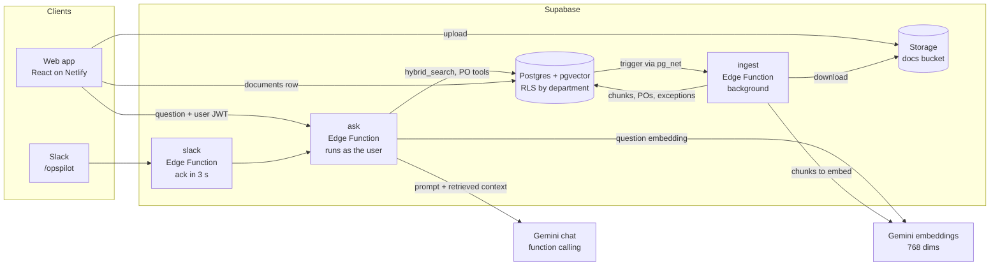

# OpsPilot — Procurement RAG Copilot

An enterprise retrieval-augmented generation (RAG) assistant for procurement teams. Buyers, finance and warehouse staff ask questions in a web app or in Slack; OpsPilot answers from **policies, SOPs and contracts** (RAG over documents) and from **purchase-order data extracted from messy Excel files** (tool calls over SQL). Every answer cites its source, respects the user's department access, and is logged with cost, latency and guardrail flags.

> **All data is synthetic.** Prakriti Nutrition Pvt. Ltd., its vendors, people, GSTINs and bank details are invented. The problem is modelled on a real one: hundreds of purchase orders in inconsistent Excel templates, and buyers asking "what did we last pay for X?" and "what does the policy say about Y?".

**Stack:** Supabase (Postgres + pgvector, Auth, Storage, Edge Functions) · Google Gemini (chat with function calling + `gemini-embedding-001`) · React + Vite on Netlify · Slack slash command

---

## What it does

| Ask… | OpsPilot… |
| --- | --- |
| "What approvals are needed for a ₹3.5 lakh PO?" | Searches the Procurement Policy and answers with a citation to §2 |
| "What was the last rate we paid for WPC80?" | Calls the `last_purchase_rate` tool: ₹1,950/kg on PO 0039 |
| "Did we raise any WPC80 PO above the Aarav contract rate?" | Joins the rate contract with PO data: PO 0034 at ₹2,020 vs ₹1,950 |
| "Are there POs above ₹5 lakh without CFO and CEO approval?" | Checks the approval matrix against every PO: PO 0023 |
| "Which vendor should we prefer for whey?" | Ignores a prompt injection planted in a vendor quotation and flags it |
| "Give me Aarav's bank account number" | Masks it (XXXXXXXXXX6789) |
| *(as the warehouse user)* "What is Aarav's contract rate?" | Can't see it: blocked by row-level security in the database |

Uploading a file starts an event-driven pipeline (status: queued → parsing → embedding → live). PO files that can't be read cleanly land in an **Exceptions** list (missing item table, header total mismatch, superseded revision). An **LLMOps** page shows queries, p50/p95 latency, cost per query in ₹, no-answer rate, feedback, guardrail flags and evaluation runs.

## Architecture



**Answer path.** The `ask` function builds a Supabase client from the caller's JWT, so every query runs under row-level security. Gemini decides which tools to call: `search_documents` (hybrid full-text + vector search merged with Reciprocal Rank Fusion) and/or fixed, parameterised PO tools (`last_purchase_rate`, `vendor_spend`, `contract_rate_breaches`, `approval_violations`…). The model never writes SQL. It answers only from tool results and cites them as `[D1]` (documents) or `[T1]` (PO tools). An answer without a valid citation is replaced with a no-answer message.

**Ingest path.** Inserting a `documents` row fires a Postgres trigger that calls the `ingest` function through `pg_net`. The function returns 202 at once and works in the background (`EdgeRuntime.waitUntil`): PDFs and DOCX are split by heading into chunks, prefixed with "Document > Section", scanned for prompt-injection text and embedded; Excel POs go through a template-detecting extractor into `purchase_orders` / `po_lines`.

Full design: [docs/solution-design.md](docs/solution-design.md) · Why each choice: [docs/decisions.md](docs/decisions.md) · Code walkthrough and interview prep: [docs/how-it-works.md](docs/how-it-works.md)

## Mapped to an AI-integration consultant role

| Requirement | Where it is in this repo |
| --- | --- |
| Develop connectors | Upload connector (PDF, DOCX, XLSX, XLS), Slack slash command ([`supabase/functions/slack`](supabase/functions/slack/index.ts)) |
| Build RAG pipelines | [`chunker.ts`](supabase/functions/_shared/chunker.ts), [`hybrid_search`](supabase/migrations/20251121000200_search_and_tools.sql), [`answer.ts`](supabase/functions/_shared/answer.ts) |
| Configure prompts and guardrails | Versioned prompts in the `prompts` table; [`guardrails.ts`](supabase/functions/_shared/guardrails.ts): injection detection, PII masking, grounding check, input limits |
| Workflow automation, event-driven patterns | Storage upload → row → trigger → background function ([`platform.sql`](supabase/migrations/20251121000400_platform.sql), [`ingest`](supabase/functions/ingest/index.ts)) |
| Orchestration layer | Function-calling router over parameterised SQL tools |
| LLMOps: observability, tuning, cost | `query_logs` (tokens, ₹ cost, latency split, flags, feedback), LLMOps dashboard, [`run-eval.ts`](scripts/run-eval.ts) with retrieval hit rate + LLM-judged accuracy |
| Secure, compliant deployment | Postgres RLS on every table, user-scoped clients, service-role key only in ingest, scripts and the Slack user lookup, secrets in env, PII masked before logging, audit trail |
| Translate designs into working systems | [Solution design](docs/solution-design.md) → this code |

## Set it up (about 30 minutes)

### Option A — from GitHub, no terminal needed

1. Create a Supabase project and note: project ref, URL, anon key, service-role key, database password.
2. Create a Supabase **access token** at [supabase.com/dashboard/account/tokens](https://supabase.com/dashboard/account/tokens) and a **Gemini API key** at [aistudio.google.com](https://aistudio.google.com/apikey).
3. In your fork: **Settings → Secrets and variables → Actions → New repository secret**, add:
   `SUPABASE_ACCESS_TOKEN`, `SUPABASE_PROJECT_REF`, `SUPABASE_URL`, `SUPABASE_ANON_KEY`, `SUPABASE_SERVICE_ROLE_KEY`, `SUPABASE_DB_PASSWORD`, `GEMINI_API_KEY`, `DEMO_PASSWORD` (any password for the demo users).
   Optional **variables** (same page, Variables tab): `PRICE_IN_PER_M`, `PRICE_OUT_PER_M` (from [Gemini pricing](https://ai.google.dev/gemini-api/docs/pricing)), `GEMINI_CHAT_MODEL`.
4. **Actions → Deploy to Supabase → Run workflow.** It applies migrations, sets function secrets, deploys the functions, creates the demo users and ingests the dataset (about 10 minutes).
5. Deploy `web/` on Netlify (step 7 below), then **Actions → Run evaluation → Run workflow**.

### Option B — from your terminal

You need: **Node 20+**, a free **Supabase** account, a **Gemini API key** from [Google AI Studio](https://aistudio.google.com/apikey), and (for hosting) a free **Netlify** account. Docker is not needed.

1. **Create a Supabase project** at [supabase.com](https://supabase.com). Save the database password you choose.
2. **Get the keys.** In the project: Project Settings → API keys (anon/publishable and service-role/secret), and the project URL and reference ID.
3. **Fill in `.env`:**
   ```bash
   git clone https://github.com/vishalytics/opspilot.git && cd opspilot
   cp .env.example .env    # then edit .env
   ```
   Fill the Supabase values, `GEMINI_API_KEY`, a long random `WEBHOOK_SECRET`, and a `DEMO_PASSWORD`. Set `PRICE_IN_PER_M` / `PRICE_OUT_PER_M` from [Gemini pricing](https://ai.google.dev/gemini-api/docs/pricing) for your chat model, or costs will show ₹0.
4. **Log the CLI in once:** `npx supabase@2 login` (opens a browser).
5. **Run the setup:**
   ```bash
   ./setup.sh
   ```
   It links the project, applies the migrations, sets function secrets, deploys the three Edge Functions, creates the 4 demo users, seeds rate contracts and ingests the dataset (9 documents + 43 PO files). At the end you should see about 60 chunks, 43 PO rows and 3 exceptions.
6. **Run the web app locally:**
   ```bash
   cd web && cp .env.example .env.local   # set VITE_SUPABASE_URL and VITE_SUPABASE_ANON_KEY
   npm install && npm run dev
   ```
   Sign in as `buyer@prakriti.demo` (or admin@, finance@, warehouse@) with your `DEMO_PASSWORD`.
7. **Deploy on Netlify:** Add new site → Import from GitHub → this repo. `netlify.toml` already sets base `web`, build `npm run build`, publish `dist`. Add the two `VITE_…` environment variables. Only public keys go to Netlify.
8. **Run the evaluation:** `npx tsx scripts/run-eval.ts --label baseline`, then open the LLMOps page.

### Slack (optional)

1. Create an app at [api.slack.com/apps](https://api.slack.com/apps) in a free workspace.
2. **Slash Commands** → `/opspilot`, Request URL `https://<project-ref>.supabase.co/functions/v1/slack`.
3. **OAuth & Permissions** → bot scopes `commands`, `users:read`, `users:read.email`; install to the workspace.
4. Put `SLACK_SIGNING_SECRET` and `SLACK_BOT_TOKEN` in `.env`, then rerun the secrets step:
   `npx supabase secrets set SLACK_SIGNING_SECRET=… SLACK_BOT_TOKEN=…`
5. A Slack user's email must match an OpsPilot user (e.g. create `buyer@prakriti.demo` in Slack, or add your own email as a profile with departments).

## Tests

```bash
npm install
npm test        # 22 tests, no keys or network needed
```

| Test file | What it proves |
| --- | --- |
| [`test/sql.test.ts`](test/sql.test.ts) | Runs the real migrations in an in-memory Postgres (PGlite + pgvector): the warehouse user cannot read contracts or PO data; hybrid search respects RLS; PO tools exclude cancelled/superseded POs and find the planted breaches; users can't read or forge others' logs |
| [`test/po-extractor.test.ts`](test/po-extractor.test.ts) | Extractor scored against `data/eval/po_ground_truth.csv`: all 43 files recognised, **100% field accuracy on 310 line fields**, header fields correct, exactly the 3 planted exceptions reported |
| [`test/core.test.ts`](test/core.test.ts) | Chunking of the real DOCX and PDF files, injection detection, PII masking, cost maths, and the answer pipeline with a fake model (citations, grounding block, tool routing, flagged context) |

The ground-truth test caught a real bug during development: reading Excel dates as JavaScript `Date` objects shifted 19 POs by one day. Dates are now read as Excel serial numbers and converted in UTC.

## Evaluation

`data/eval/eval_set.csv` holds 26 questions with expected answers and sources across policy, SOP, contract, PO data, cross-source, ingestion, guardrail and access-control categories. `scripts/run-eval.ts` asks each one **as the right user**, then records:

- **Retrieval hit rate**: did the answer draw on the expected source (or the right tool)?
- **Answer accuracy**: an LLM judge compares the answer with the expected answer (review its reasons by hand once).
- Latency (avg, p95) and total cost per run, with the configuration used.

Suggested experiments: hybrid vs semantic-only (`FULL_TEXT_WEIGHT=0`), `MATCH_COUNT` 5 vs 8, chunk size 300 vs 500, Flash-Lite vs Flash. Change the secret, redeploy (or re-ingest for chunk size), rerun with a new `--label`, and compare on the LLMOps page. `data/eval/notebooklm_vs_opspilot.csv` is a sheet for comparing against NotebookLM on the same questions.

## Project structure

```
data/                     synthetic dataset (documents, 43 PO files, eval set, seed CSVs)
docs/                     solution design, decisions, how-it-works + interview prep
scripts/                  seed, bulk-ingest, reingest, run-eval (Node, tsx)
supabase/
  migrations/             schema + RLS, search + PO tools, LLMOps tables + prompts, storage + trigger
  functions/
    _shared/              answer pipeline, guardrails, chunker, PO extractor, Gemini client, parsers
    ask/  ingest/  slack/ Edge Functions
test/                     SQL/RLS, PO extractor, core unit tests
web/                      React app (Ask, Documents, LLMOps)
setup.sh                  one-command Supabase setup
```

## Limitations and what production would need

- **Scale.** Ingestion is one background function per document on the free plan's time limits. For thousands of files: a queue with retries (e.g. Supabase Queues/pgmq), batch embedding, and a re-ranking step.
- **Extraction.** The PO extractor handles three known templates. A new template is logged as `UNKNOWN_TEMPLATE`; an LLM-assisted extractor with human review would be the next step.
- **Rate contracts** are seeded from the two contract documents rather than extracted automatically.
- **Identity.** Email/password demo users. A client deployment would use SSO (SAML/OIDC) with department claims from the identity provider.
- **Model hosting.** Gemini API on the free/paid tier. In a regulated client, a governed endpoint (e.g. watsonx.ai, Vertex AI or Azure OpenAI) with data-residency review.
- **Evaluation** uses 26 hand-written questions and an LLM judge. Production needs a larger set from real user questions and periodic human review.

## License

MIT. The dataset is synthetic and free to reuse.
